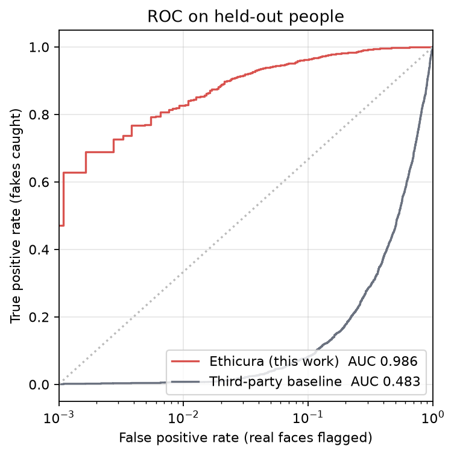
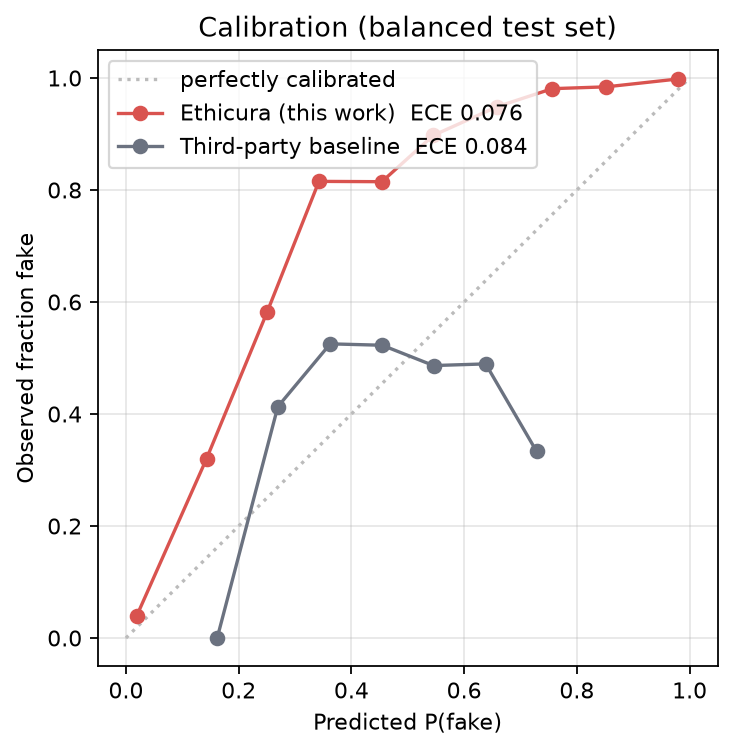
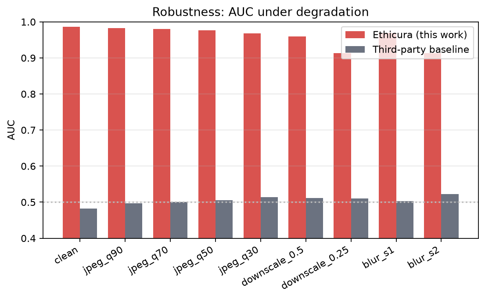

# ‣ Ethicura AI — Unified DeepFake Detection Framework (UDDF)

[](https://github.com/a77chand/ethicura-ai/actions/workflows/tests.yml) [](https://ethicura-frontend.vercel.app)

> *Empowering digital trust through real-time, interpretable deepfake detection.*

### At a glance
- **[Live demo](https://ethicura-frontend.vercel.app):** a webcam deepfake detector that runs **entirely in the browser** (WebGPU, about 30 analyses per second). No server is involved and no video is uploaded.
- **Its own trained model:** an EfficientNetB0 trained on 120k images (DeepFakeFace). It scores **AUC 0.986** on people never seen in training, catches **82.7% of fakes at a 1% false-alarm rate**, and is calibrated to ECE 0.011. The third-party model it replaced scores 0.48, which is chance.
- **Evaluation built to avoid fooling ourselves:**
  - Splits are by person, and real-vs-fake shortcuts found in the data are removed.
  - Confidence intervals come from a person-level bootstrap.
  - Robustness is tested under compression and blur, generalisation is tested on unseen generators, and a separate video dataset serves as a cross-dataset test.
  - The weak spots are stated plainly: unseen face swaps score 0.765, and cross-dataset video scores 0.63.
- **The browser demo is measured too:** its exact pipeline, run in headless Chrome on the same test set, scores AUC 0.982.
- **Explainable:** every score comes with a Grad-CAM heatmap. In the browser this is computed without a backward pass.
- **Benchmarked against a PyTorch CLIP probe (UnivFD):** CLIP generalises much better to unseen face swaps (0.932 vs 0.765) and out-of-domain video (0.708 vs 0.627), while the fine-tuned model wins in-distribution. This points to the next step (see [below](#pytorch-baseline-clip-linear-probe)).


## ‣ Live Demo:

**[ethicura-frontend.vercel.app](https://ethicura-frontend.vercel.app)**: live webcam deepfake analysis with a heatmap overlay. It runs **entirely in your browser**, and your video never leaves the device:

- **Face tracking:** MediaPipe BlazeFace finds the face on every video frame.
- **Classifier:** an ONNX export of Ethicura's **own trained detector** (AUC 0.986 on people it never saw; see [Results](#-results)) runs on your GPU through WebGPU, falling back to WebAssembly.
- **Speed:** about 30 analyses per second at about 20 ms each on a laptop, with no server and no network round trip.
- **Accuracy, measured in the browser itself:** the demo's exact pipeline was run in headless Chrome over the same 8,057 test faces (people never seen in training). It scores **AUC 0.982** (0.980–0.985), against 0.986 for the Python/MTCNN pipeline, with 93.4% balanced accuracy and calibration error 0.014. BlazeFace finds no face in 2.2% of images. Details: [`results/browser_pipeline.json`](results/browser_pipeline.json) and the [harness](https://github.com/a77chand/ethicura-frontend/tree/main/eval).

### How the browser version matches the Python API
- **Heatmap without a backward pass.** The classifier head is global-average-pool → dropout → dense(sigmoid), so Grad-CAM's channel weights reduce to a positive scalar times the dense weights. After ReLU and normalisation, Grad-CAM equals classic CAM, `ReLU(Σₖ wₖ Aₖ) / max`. The exported graph computes that directly. [`training/export_web.py`](training/export_web.py) checks the result against `src/gradcam.py` numerically before it writes the model.
- **Same preprocessing.** The browser resizes face crops with a JavaScript port of OpenCV's bilinear resize, the one used in training. The canvas's own smoothing filter shifted predictions noticeably.
- **Crop parity.** The model was trained on MTCNN face crops, but the browser uses BlazeFace. A small ridge regression from BlazeFace's six landmarks maps its box onto MTCNN's (median crop overlap 0.92 with the API's crop over 73 frames).
- **Per-frame agreement with the API** on 73 video frames:
  - **Identical crops:** browser and Python probabilities differ by a median of 0.005 (max 0.06), and 72 of 73 labels match.
  - **The browser's own face detector:** 66 of 73 single-frame labels match. The two detectors box turned heads differently, and some scores near 50% flip. On the full test set this costs only 0.004 AUC (above).
- **No separate browser calibration.** A Platt correction fitted on the browser pipeline's validation scores came out near the identity (scale 0.92, shift 0.16) and only moved test calibration error from 0.014 to 0.010. The browser and the API therefore ship the same model.
- **Correction to an earlier version of this README:** it reported a 0.0004 maximum browser/API difference. That was measured against the old third-party model, which outputs about 0.497 for every face, so any crop agreed.

## ‣ Demo Video (original version):

[https://github.com/user-attachments/assets/demo.mp4](https://github.com/a77chand/ethicura-ai/raw/main/assets/api_3.mp4)

> This recording predates the current model. It shows the original XceptionNet version of Ethicura AI analysing a video of Elon Musk, flagging it as a deepfake with a 57.5% fake score and a Grad-CAM overlay. To see the current detector, try the [live demo](https://ethicura-frontend.vercel.app).

---

## ‣ The Problem:

Deepfake technology makes it trivially easy to manipulate digital content — spreading misinformation, invading privacy, and damaging reputations. Individuals, businesses, and institutions face growing threats from scams, identity theft, and fake social media content.

We built Ethicura AI to give people a proactive, interpretable tool to verify content authenticity and rebuild trust in digital media.

---

## ‣ Our Solution:

**Ethicura AI** is an end-to-end deepfake detection API and interface that:

- Detects manipulated **images and videos** with an **EfficientNetB0 trained in-house** on DeepFakeFace (AUC 0.986 on unseen people), using **MTCNN** for face extraction
- Supports **live webcam analysis in the browser**: a React frontend runs face tracking and an ONNX export of the classifier on-device (WebGPU), with no server and no upload
- Provides **real-time confidence scores** (fake probability 0–100%)
- Generates **Grad-CAM visualisations** to highlight the exact facial regions that triggered the detection — making the model's decision transparent and auditable
- Is trained and tested on three kinds of fake face: **diffusion inpainting, face swap and fully generated (text-to-image) faces**. It scores frame by frame; videos are averaged over frames, with no temporal model

---

## ‣ Architecture:

One trained model serves two pipelines:

```
                 Python API (this repo)                    Live demo (browser, ethicura-frontend)
                 ──────────────────────                    ──────────────────────────────────────
Input            image / video upload                      webcam frame
                        │                                           │
Face             MTCNN, 20% margin                         MediaPipe BlazeFace + 6 landmarks
                        │                                  → ridge map onto the MTCNN-style crop
                        │                                           │
Preprocess       cv2.resize → 224×224, [0,1]               JS port of cv2 bilinear resize → 224×224
                        │                                           │
Classify         EfficientNetB0 (Keras, CPU)               same weights, ONNX on WebGPU / WASM
                 Platt calibration folded in               (exported by training/export_web.py)
                        │                                           │
Explain          Grad-CAM (traced fwd + bwd pass)          CAM in-graph (equal to Grad-CAM for
                        │                                   this head; no backward pass)
                        ▼                                           ▼
Output           P(fake) + heatmap/overlay                 P(fake), averaged over 8 frames, + heatmap
```

`training/run.py` produces the model: DeepFakeFace → MTCNN crops (the same code as the API) → TFRecords → fine-tune → Platt calibration → evaluation.

---

## ‣ Results:

Ethicura's detector was trained and evaluated with the leakage-controlled pipeline described [below](#-how-the-model-was-trained-and-evaluated). It's compared with the third-party pretrained model ([`ariyul/deepfake-detection-cnn_v2`](https://huggingface.co/ariyul/deepfake-detection-cnn_v2)) that the project used before, on identical face crops. That model has to be fed 0–255 pixels to work at all. Its model card says to divide by 255, but Keras' EfficientNet already does that internally, so it outputs about 0.497 for every face. The comparison below gives it the input it needs.

<!-- results:start -->
Test set: **1,838 real and 6,219 fake faces** from people never seen in training (faces ≥ 80 px). 95% CIs from a person-level bootstrap.

| Metric | Ethicura (this work) | Third-party baseline |
|---|---|---|
| AUC (95% CI) | **0.986 (0.984–0.988)** | 0.483 (0.470–0.496) |
| Equal error rate | **5.6%** | 51.3% |
| Fakes caught at 1% false alarms | **82.7%** | 0.6% |
| Fakes caught at 5% false alarms | **94.0%** | 3.9% |
| Balanced accuracy @ 0.5 | **94.6%** | 48.6% |
| Calibration error (ECE, balanced) | **0.011** | 0.084 |

**Per generator** (real test faces vs. one generator's fakes):

| Generator | Ethicura AUC | Baseline AUC |
|---|---|---|
| SD inpainting | **0.986 (0.983–0.988)** | 0.474 (0.462–0.486) |
| InsightFace swap | **0.987 (0.983–0.990)** | 0.497 (0.477–0.515) |
| SD text-to-image | **0.986 (0.983–0.988)** | 0.478 (0.461–0.496) |

**Generalisation to an unseen generator.** Each row is a model trained *without* that generator, tested on it, next to the full model that did see it in training:

| Held-out generator | AUC, never seen | AUC, seen in training | Same held-out model on the generators it saw |
|---|---|---|---|
| SD inpainting | 0.939 (0.933–0.946) | 0.986 (0.983–0.988) | 0.983 |
| InsightFace swap | 0.765 (0.750–0.779) | 0.987 (0.983–0.990) | 0.993 |
| SD text-to-image | 0.946 (0.939–0.952) | 0.986 (0.983–0.988) | 0.988 |

**Robustness** (AUC with the degradation applied to every test face, real and fake):

| Condition | clean | JPEG q90 | JPEG q70 | JPEG q50 | JPEG q30 | downscale ×0.5 | downscale ×0.25 | blur σ=1 | blur σ=2 |
|---|---|---|---|---|---|---|---|---|---|
| Ethicura | 0.986 | 0.982 | 0.980 | 0.976 | 0.968 | 0.959 | 0.913 | 0.969 | 0.913 |
| Baseline | 0.483 | 0.497 | 0.501 | 0.505 | 0.515 | 0.512 | 0.511 | 0.503 | 0.523 |

**Out of domain: SDFVD face-swap videos** (a different dataset and manipulation tool, never used for training or model selection):

| | Ethicura | Baseline |
|---|---|---|
| Frame-level AUC | **0.618 (0.557–0.676)** | 0.584 (0.541–0.632) |
| Video-level AUC (mean over frames, 106 videos) | **0.627 (0.558–0.697)** | 0.588 (0.539–0.643) |

Training: 15,296 real faces per epoch against the same number of fakes, best epoch 8 of 8, 16.0 min on a GPU. Calibration: Platt scaling (a = 1.02, b = 1.93 on the raw logits) fitted on balanced validation (ECE 0.009) and folded into the final layer.
<!-- results:end -->

| ROC on held-out people | Calibration | Robustness |
|---|---|---|
|  |  |  |

**What the numbers say**
- **Strong in-distribution detection:** AUC 0.986 on people never seen in training. It catches 83% of fakes while flagging only 1% of real faces.
- **Calibrated:** when it says 80% fake, about 80% of such faces are fake (ECE 0.011 on a balanced test set). That matters because the demo shows the percentage, not just a label.
- **Robust to degraded input:** AUC stays at 0.968 or above down to JPEG quality 30, and above 0.91 under ×0.25 downscaling or heavy blur.
- **Face swaps are the hardest to generalise to.** A model that never saw InsightFace swaps scores only 0.765 on them, against about 0.94 for the unseen diffusion generators. Swap artefacts are evidently different enough from diffusion ones that training on one doesn't cover the other.
- **Out of domain, it's a weak detector.** On SDFVD (commercial face-swap videos, a different dataset entirely), video-level AUC is about 0.63. The baseline's confidence interval overlaps it, so that's not a clear win. Like most detectors trained on one dataset, it shouldn't be trusted on manipulation types it wasn't trained on. This is why the live demo labels its output a *warning*, not a verdict.

Full numbers are in [`results/results.json`](results/results.json), with per-run training metadata in `results/models/`. The tables above are generated from those files by `python -m training.report results --readme README.md`.

### PyTorch baseline: CLIP linear probe

As a reference point, [`probes/clip/`](probes/clip/) trains the **UnivFD** recipe (Ojha et al., CVPR 2023) in PyTorch: a single `nn.Linear` on **frozen** CLIP ViT-B/16 image features. It uses the same face crops, splits, filters, Platt calibration and metrics code as the main model, and reads the data read-only.

<!-- clip:start -->
| | Ethicura EfficientNetB0 (fine-tuned) | CLIP ViT-B-16 (openai), frozen + linear probe |
|---|---|---|
| AUC (95% CI) | **0.986 (0.984–0.988)** | 0.970 (0.967–0.974) |
| Fakes caught at 1% false alarms | **82.7%** | 66.9% |
| Balanced accuracy @ 0.5 | **94.6%** | 91.0% |
| Never saw SD inpainting | 0.939 (0.933–0.946) | **0.963 (0.958–0.968)** |
| Never saw InsightFace swap | 0.765 (0.750–0.779) | **0.932 (0.924–0.939)** |
| Never saw SD text-to-image | **0.946 (0.939–0.952)** | 0.903 (0.894–0.912) |
| SDFVD video-level AUC (out of domain) | 0.627 (0.558–0.697) | **0.708 (0.640–0.770)** |
<!-- clip:end -->

**What it shows:**
- **The fine-tuned EfficientNet is best on generators it was trained on** (AUC 0.986 vs 0.970).
- **Frozen CLIP features generalise far better** to what wasn't in training:
  - Unseen InsightFace swaps: **0.932 vs 0.765**.
  - Unseen inpainting: 0.963 vs 0.939.
  - Out-of-domain SDFVD videos: **0.708 vs 0.627**.
- **This matches the UnivFD finding:** fine-tuning a CNN specialises it to its training generators, while large pretrained features carry more general "real image" structure.
- **The one exception is unseen text-to-image fakes,** where the EfficientNet stays ahead (0.946 vs 0.903).
- **The obvious next experiment** is to combine the two: fine-tuned CNN features and CLIP features, or a light fine-tune of CLIP itself.

```bash
pip install -r probes/clip/requirements.txt
python -m probes.clip.run_probe --model ViT-B-16 --crops /path/to/crops --cache /tmp/clip_cache
```

### Historical: the original research model

The project started with an XceptionNet fine-tuned on FaceForensics++. Its trained weights were never committed to this repo, so it can't be re-evaluated. These are the figures reported at the time:

| Model | Accuracy (%) | Precision (%) | Recall (%) | F1-Score (%) | AUC-ROC |
|-------|-------------|---------------|------------|--------------|---------|
| **XceptionNet (Ours)** | **95** | **93** | **92** | **92.5** | **0.97** |
| MesoNet | 88 | 85 | 86 | 85.5 | 0.9 |
| VA (SVM) | 80 | 78 | 75 | 76.5 | 0.85 |
| ClassNSeg | 92 | 90 | 89 | 89.5 | 0.93 |
| CapsuleNet | 85 | 82 | 83 | 82.5 | 0.88 |
| FWA | 78 | 76 | 72 | 74 | 0.8 |
| DSSPFWA | 90 | 88 | 86 | 87 | 0.91 |
| Upcov | 82 | 80 | 79 | 79.5 | 0.85 |
| WM (EfficientNet) | 94 | 92 | 91 | 91.5 | 0.96 |
| SeimSafer (EfficientNet) | 92 | 90 | 89 | 89.5 | 0.94 |
| CNNDetection | 91 | 89 | 88 | 88.5 | 0.93 |

*As reported originally; not reproducible from this repository.*

---

## ‣ How the Model Was Trained and Evaluated:

[`training/run.py`](training/run.py) runs the whole pipeline end to end. [`training/kaggle/`](training/kaggle/) runs it on free Kaggle compute: a CPU job builds the face crops once, and a GPU job trains from them.

**Data**
- **[DeepFakeFace](https://huggingface.co/datasets/OpenRL/DeepFakeFace)** (OpenRAIL): 30k real IMDB-WIKI photos. Each has one fake from each of three generators: Stable Diffusion inpainting, InsightFace face swap and Stable Diffusion text-to-image.
- **[SDFVD](https://huggingface.co/datasets/Hemgg/SDFVD-video-dataset):** 53 real and 53 face-swapped videos from a commercial tool. It's used **only as an out-of-domain test set**.

**Shortcut controls.** Inspecting the raw data showed two easy cues that have nothing to do with manipulation:
- **Size and format:** real photos have varied sizes, about 7.5% are grayscale, and some are PNG. Every fake is a 512×512 colour JPEG.
- **Sharpness:** small real faces upscale to blur, while the fakes are sharp.

A model can score well by learning these cues and then fail on real webcam input. The pipeline closes them as follows:
- **Grayscale images are dropped** from every class.
- **Every image goes through the API's own MTCNN face crop** and is re-encoded identically, which removes size and format differences.
- **Faces under 80 px wide are dropped.** Training also applies random blur, downscaling and JPEG recompression (q35–100) to **both** classes, so sharpness and compression carry no label information.
- **Splits are by person (80/10/10):** a celebrity's real photo and all of its fakes always land in the same split.

**Training**
- **Model:** EfficientNetB0 (ImageNet), chosen for CPU latency in the live service and WebGPU in the browser.
- **Schedule:** the head is trained first on the frozen backbone, then the whole network is fine-tuned with AdamW and cosine decay.
- **Batches are class-balanced,** with the fakes split evenly across the generators.
- **Checkpoint selection:** the best epoch is chosen by validation AUC.
- **Calibration:** Platt scaling (a scale and a shift of the logit) is fitted on a 50/50 validation slice and folded into the final layer, so P(fake) is calibrated at no runtime cost. Temperature scaling alone couldn't fix the model's under-confidence on fakes. Calibration runs as a separate step on the saved model file, so it always matches the file that ships.

**Evaluation** (held-out people, compared against the third-party baseline on identical crops)
- **Headline metrics:** AUC with a 95% CI from a person-level bootstrap, EER, the detection rate at 1% and 5% false-positive rates, and balanced accuracy.
- **Calibration:** ECE and reliability diagrams on a class-balanced test set.
- **Per-generator AUC:** inpainting, face swap and text-to-image reported separately.
- **Robustness:** AUC under JPEG q90/70/50/30, ×0.5 and ×0.25 downscaling, and Gaussian blur.
- **Unseen generators:** three extra models are trained, each with one generator left out, then tested on that generator.
- **Cross-dataset:** frame-level and video-level AUC on SDFVD face-swap videos.

```bash
pip install -r requirements-dev.txt
python -m training.run all --data /tmp/ethicura --out results              # full run (GPU recommended)
python -m training.run all --data /tmp/ethicura --out results --limit 50   # quick smoke test
```

---

## ‣ Project Structure:

```
ethicura-ai/
├── src/
│   ├── detector.py          # Core detection pipeline (MTCNN + EfficientNetB0 + Grad-CAM)
│   ├── gradcam.py           # Grad-CAM visualisation module
│   └── api.py               # FastAPI REST endpoints (incl. webcam /predict_frame)
├── demo/
│   └── run_demo.py          # Standalone demo script
├── assets/
│   ├── summary.png          # Project overview image
│   ├── api_3.mp4            # Demo video
│   └── eval/                # ROC, calibration and robustness charts
├── docs/
│   └── model_card.md        # Model card for the shipped detector (data, metrics, limitations)
├── training/
│   ├── export_web.py        # Keras → ONNX (prob + CAM) for the in-browser demo, with parity checks
│   ├── run.py               # Train + evaluate an in-house model (download → crops → train → evaluate)
│   ├── kaggle/              # Runs run.py on a free Kaggle GPU
│   ├── data.py, model.py, metrics.py
│   ├── report.py            # Generates the README results tables from results/
├── probes/clip/             # PyTorch CLIP linear-probe baseline (UnivFD), read-only on the crops
├── results/                 # results.json, browser_pipeline.json, per-run training metadata
├── tests/                   # pytest suite (model contract, calibration, metrics, data pipeline)
├── models/                  # ethicura_effnetb0.keras: the trained, calibrated detector
├── fetch_and_test_model.py  # Downloads the old third-party baseline and runs a smoke test
├── test_full_pipeline.py    # End-to-end test: face detection → classification → Grad-CAM
├── modal_app.py             # Modal deployment (hosts the live API)
├── Dockerfile               # Container image for other hosts
├── render.yaml              # Render deployment config
├── requirements.txt
└── README.md
```

The in-browser frontend (React + Vite, ONNX Runtime Web, MediaPipe) lives in its own repo: **[a77chand/ethicura-frontend](https://github.com/a77chand/ethicura-frontend)**.

---

## ‣ Setup & Usage:

### 1. Clone and install
```bash
git clone https://github.com/a77chand/ethicura-ai.git
cd ethicura-ai
pip install -r requirements.txt
```

### 2. Run on an image
```python
from src.detector import EthicuraDetector

detector = EthicuraDetector()
result = detector.predict("path/to/image.jpg")

print(f"Prediction: {result['label']}")          # FAKE or REAL
print(f"Confidence: {result['confidence']:.1f}%")
# result['gradcam_overlay'] contains the annotated image
```

### 3. Run on a video
```python
result = detector.predict_video("path/to/video.mp4")
print(f"Fake frames detected: {result['fake_frame_count']} / {result['total_frames']}")
print(f"Overall verdict: {result['verdict']}")
```

### 4. Run the API server
```bash
uvicorn src.api:app --reload
# API available at http://localhost:8000
```

The API loads Ethicura's trained detector from `models/ethicura_effnetb0.keras` (17 MB, in the repo).

| Endpoint | Method | Description |
|----------|--------|-------------|
| `/health` | GET | Health check; `model_ready` turns true once the model is loaded and warmed up |
| `/model-info` | GET | Model and benchmark summary |
| `/predict` | POST | Upload an image or video (multipart `file`) → label, confidence, per-video stats |
| `/predict/gradcam` | POST | Upload an image → Grad-CAM overlay as PNG (label/confidence in `X-Ethicura-*` headers) |
| `/predict_frame` | POST | JSON `{"image_base64": "..."}` → label, confidence, `face_bbox` and the raw 7×7 Grad-CAM `heatmap` (~500 bytes), for clients that stream frames to a server (the live demo runs in the browser instead). Add `"include_overlay": true` to also get the annotated frame as base64 PNG |

The models load and warm up in a background thread at startup, so the port opens immediately and `/health` reports when inference is ready. Classification and Grad-CAM share a single traced forward/backward pass. On an Apple-silicon laptop a webcam frame takes about 130 ms end to end.

### 5. Run the webcam frontend
```bash
git clone https://github.com/a77chand/ethicura-frontend.git && cd ethicura-frontend
npm install
npm run dev
```
The frontend runs the model in the browser and doesn't need this API. To regenerate its model file from a Keras model, run:
```bash
python -m training.export_web --out ../ethicura-frontend/public/models/detector.onnx [--model path/to/model.keras]
```

### 6. Deploy
The live demo is a static site on Vercel and needs no backend: all inference runs in the browser.

To host the FastAPI service anyway (for image and video uploads), use one of these:
- `modal_app.py` deploys it on [Modal](https://modal.com) with `modal deploy modal_app.py`. Expect about a 22 s cold start and about 170 ms per frame.
- The `Dockerfile` builds a self-contained image (model baked in, port 7860) for any container host, including Hugging Face Docker Spaces, which now require a PRO plan.
- `render.yaml` is kept for Render, but the free tier's 512 MB RAM / 0.1 CPU is too small for live webcam use.

XLA JIT is disabled in `src/api.py` because its first-call compile stalled for many minutes on constrained CPUs.

---

## ‣ Next Steps:

These are the measured weak spots, in priority order:
- **Generalise to unseen face swaps:** this scores 0.765. A frozen CLIP probe already reaches 0.932 here (see the PyTorch baseline). The next step is to fuse CLIP features with the fine-tuned CNN, or lightly fine-tune CLIP, and to train on more swap pipelines (SimSwap, FaceFusion and similar).
- **Cross-dataset video:** this scores 0.63. Fixes would be adding real video data for training, and a temporal model across frames, since detection is currently frame by frame.
- **Subgroup evaluation:** collect or annotate demographic labels and report per-group error rates.
- **Browser crops:** fine-tune on BlazeFace crops as well as MTCNN crops, to close the remaining 0.004 AUC gap and the per-frame flips on turned heads.

## ‣ Future Potential:

- **Education & e-learning**: Verify authenticity of online instructional content, exams, and interviews
- **Professional networking**: Assist platforms like LinkedIn, Glassdoor, and HR systems in verifying user genuineness
- **Multilingual support & voice-guided interfaces** for accessibility and inclusivity
- **Real-time browser extension** for social media verification

---

## ‣ Technical Stack:

| Component | Technology |
|-----------|-----------|
| Face Detection | MTCNN (Multi-Task Cascaded CNN) |
| Classification | EfficientNetB0, trained in-house on DeepFakeFace |
| Training & evaluation | TensorFlow `tf.data`, Kaggle (free CPU + GPU jobs), scikit-learn metrics, person-level bootstrap |
| Baseline | PyTorch + OpenCLIP (CLIP ViT-B/16 linear probe, UnivFD recipe) |
| Testing | pytest, GitHub Actions CI |
| Interpretability | Grad-CAM (Class Activation Mapping) |
| API | FastAPI |
| Frontend | React + Vite, hosted on Vercel |
| In-browser inference | ONNX Runtime Web (WebGPU / WebAssembly), MediaPipe BlazeFace |
| Deep Learning | TensorFlow / Keras |
| Video Processing | OpenCV |
| Optional API hosting | Modal or any container host |

---

## ‣ Ethics & Responsible AI:

Ethicura AI was built with responsible deployment in mind:
- Grad-CAM explanations make decisions **interpretable**, not black-box
- Intended as a **warning tool**, not a definitive judge — users retain agency
- The live demo processes video **on-device**, with nothing uploaded; the API doesn't store uploaded content
- **No subgroup (demographic) evaluation yet:** the dataset has no reliable demographic labels, so equal performance across groups isn't established
- See the [model card](docs/model_card.md) for intended use, limitations and bias considerations

--- 
